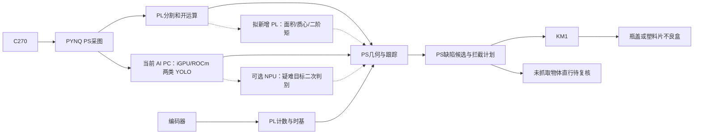

# 轻质零件外观缺陷检测与动态剔除 最终参赛方案

> 2026-10-26 路线更新：本文保留历史动态剔除设计。当前正式作品为“基于FPGA的可回收物智能分拣系统”，请使用[当前总方案](../../docs/design/static_waste_sorting_plan.md)和[从零实施手册](../../docs/design/recyclable_sorting_from_zero.md)。以下“当前”“最终”均属于原记录时点。

方案v6，2026-10-07。作品目标为“基于FPGA与AI PC协同的轻质零件在线外观缺陷检测与动态剔除系统”，面向AMD具身智能赛道。检测两种零件的六种外观状态，持续跟踪并剔除四种缺陷状态；首批以瓶盖三状态开始，最终增加带孔塑料片。控制器继续使用现有v5代码，版本名不表示新增硬件功能已经实现。

**实施更新2026-10-16：**AMD AI PC 已到位并成为当前上位机，原拯救者 Y9000P 已退出当前使用。HX 370/Windows 11 实机及 ROCm 基础检查见[环境记录](../../docs/team/reviews/2026-10-16-hx370-environment.md)；驱动更新及 GPU 复验已完成，本队模型和板端通信仍待完成。其他设备沿用已有记录，未据此更新输送带或编码器验收状态。具体执行顺序见[完整开工手册](commissioning_roadmap.md)，正式环境见[HX 370 Windows部署](amd_deployment.md)。以下是设计，不表示已有实机成绩。

### 2026-10-16 当前两类实施路线

先完成正常/变形瓶盖两类闭环，六状态保留为后续扩展。相机继续接 PYNQ，由 PS 采图后分别交给 PL 图像核和 AI PC；AI PC 的 iGPU 通过 ROCm 运行 YOLO，结果与 PL 掩码、编码器位移在 PS 汇合，PS 负责目标关联、预测和 KM1 动作调度。PYNQ 上的 Python 调度不算 PL 硬件实现，现有串口动作也不宣称硬实时闭环控制。

在现有分割/开运算与编码器核基础上，下一步考虑实现面积、质心和二阶矩等 PL 几何特征核，为定位及形状分析提供数据，减少 PS 逐像素计算。这些核尚未实现，具体范围和资源预算在开发任务中确定；形状特征是否改善变形识别需用独立样本验证。对照同一输入、模型、带速下的 CPU/PL 路径，统计包含 DMA 的处理耗时、位置更新间隔和整机剔除效果。

NPU 二次判别保留为可选实验，当前没有 NPU 部署或第二模型；仅在明确疑难样本任务并验证效果、延迟或功耗收益后接入。当前优先完成 ROCm 本队模型、板端通信及编码器链路，再推进 PL 特征核。

## 1. 应用对象与工作条件

正式范围为两种零件、六种互斥状态：瓶盖正常(cap_ok)/缺口(cap_notch)/明显变形(cap_deformed)，带孔塑料片正常(plate_ok)/缺角(plate_corner_missing)/缺孔(plate_hole_missing)。正常状态仍需检测和标注；arm.bins只包含4个缺陷键，瓶盖缺陷进入瓶盖不良盒，塑料片缺陷进入塑料片不良盒。同规格、同材质和同色样件均应同时有正常及缺陷状态，避免模型仅学颜色或制造批次。

C270只验收当前分辨率与光照下清楚可见的缺陷，不覆盖密封性、内部缺陷、微裂纹或功能质量。缺口、形变、缺角和缺孔的尺寸与像素可见性必须写进样件标准。完整备料、标注、划分和训练步骤见[开工手册第8节](commissioning_roadmap.md#8-第六步两种零件六种状态的外观缺陷检测)。

本轮文档与迁移样例已更新，运行默认配置仍保留原状。config/defect_board.json、data/defect_dataset.yaml为新样例；按手册8.2备份并迁移到板端根config.json后才使用新动作策略，不把旧四类配置直接配上六状态模型。

固定俯视相机覆盖输送带观察区、抓取窗口及分类盒。输送带低速连续运行，直线运动、速度稳定、物体不滚动且与带面无明显滑移；单层有间距供料。相机必须固定并标定，但不要求镜头恰好垂直，只要透视标定与夹爪可见性得到验证。当前不覆盖手持相机、密集堆叠、高速流水线或无人监管运行。

正常件不安排抓取，缺陷件是抓取候选。机械臂忙、漏检或跟踪失败的缺陷也可能流出，因此末端为直行待复核区，不能凭未抓取就判定合格；缺陷流出计为漏剔。上料间隔、带速、观察长度和机械周期共同决定吞吐。最终模式为连续运动中的预测拦截，代码没有自动停带后抓取的替代模式。

## 2. 系统分工

| 单元 | 最终职责 |
|---|---|
| AMD Ryzen AI PC | YOLO11n输出整件零件的缺陷状态/框/分数及模型指纹；PyTorch ROCm正式部署 |
| PYNQ PL 图像核 | HLS阈值分割与3×3开运算，经AXI DMA输出前景掩码 |
| PYNQ PL 编码器核 | RTL正交四倍频计数、非法跳变统计、100MHz时间计数和原子快照，经AXI GPIO读出 |
| PYNQ PS | 掩码几何、目标编号关联、异步检测结果绑定、位移补偿、有限窗口预测、逆运动学与时限调度 |
| KM1 ESP32 | 按USB串口关节指令执行拦截抓取和分类放置；没有位置/力反馈协议 |
| 相机及现场录像 | 分类盒变化作为程序证据，人工标注真实分类/抓取结果与漏抓 |

当前开发与部署主机为 AMD Ryzen AI PC。原 Windows NVIDIA/CUDA 训练与推理记录仅作历史复现和对照，不再作为当前开发机前提；训练能力也需在新环境单独验证。指南ROCm版本条款和具体SKU/OS兼容性保持独立核验，不能用NVIDIA开发结果代替AMD验收。

网络沿用一根以太网线直连的设计：当前 AI PC 的有线目标地址为192.168.2.1/24，PYNQ为192.168.2.99/24。文件传输和板端到AI PC的检测请求共享此链路；电脑Wi-Fi仅供准备阶段下载，正式闭环无需路由器或公网。板端inference.url为http://192.168.2.1:8765；新机物理网卡、地址、端口及实际通信需重新验收，旧机连通记录不代表新机已连通。

## 3. 两条更新通路

1. 板端每轮采集最新图像，利用PL掩码得到独立物体与内部抓取候选点。编码器位移补偿上一轮位置，进行严格的一对一关联；合并、交叉或多解时丢弃旧编号与类别。
2. 同时只保留一个YOLO异步请求。送检时保存该帧的几何与track_id快照；延迟返回的检测框只绑定原帧中对应的编号，绝不拿旧框去匹配当前画面。若原编号已消失，结果作废。
3. 位置更新不等待YOLO网络往返，但实际帧率仍受UVC、DMA、PS连通域和距离变换限制。“两个频率”是软件结构，不是已达到的帧率或硬实时保证。

`src/rtl/conveyor_encoder.v`负责脉冲采集与时基，`src/conveyor.py`读取一致快照，`src/moving_targets.py`关联及预测，`src/recycling_run.py`为默认任务入口。FPGA没有实现YOLO、连通域、逆运动学或机械臂闭环控制，抓取窗口判定目前由PS完成。

## 4. 时间对齐与拦截

设物体在图像中的标定位置为p、对应带位移为s，当前编码器位移为s_now，速度为v，输送方向单位向量为u。预计接触位置为：

`p_contact = p + u × (s_now - s + v × remaining_time)`。

USB相机只能提供主机读帧完成时间。配置中的采集延迟修正和不确定度必须实测；编码器PL时间与PS单调时钟通过读快照前后夹取时间近似对应。**这不是相机曝光与编码器的硬件同步**，UVC缓存、曝光和读快照抖动均进入误差预算。若误差过大，当前系统拒绝执行；硬件触发相机不在现有代码中冒充已实现。

预测窗口必须同时满足：目标编号稳定、类别新鲜、位移正常、位置位于标定与夹爪范围、预计接触点在窗口内、误差上界不超过设定值。上界包含位置标定、采集/动作时序不确定度和加速度项。默认数值是调试占位，dynamic.commissioned=false；现场测量后才能启用动作。

串口在观察前打开一次，机械臂先到观察准备位；拦截计划不重复串口复位等待。预检查全部轨迹点；移向目标上方时继续更新几何，下降前复查预测点；下降阶段监测编码器漂移，闭爪前检查时限。已发送指令不能撤销，计划超时或偏差增大时停止后续指令，由现场措施处理当前运动。

## 5. 执行反馈与异常

移动目标离开源位置不等于被抓走。程序只在分类盒前景增加满足阈值时记录bin_visual_evidence_pass；盒内遮挡、相邻物体、误放等仍可能影响判断，所以真实成功率以同步录像人工真值为准。盒满或证据不足停止批次，不自动重抓。

编码器非法跳变、时钟异常、速度越界/反向/停带、图像过期、目标歧义、检测服务异常、预测超差、串口错误和动作迟到会停止后续动作并留日志。停止程序不停止输送电机；输送带与机械臂必须有现场独立断电措施，当前无硬件急停互锁。

## 6. 验收与对照

以下是设计验收安排，不是已测成绩：

- 以实测带速分组，按六状态记录所有入场样件、真实缺陷、正常误剔、缺陷漏剔、正确缺陷盒、待复核与人工干预；建议累计至少100个入场目标。缺陷剔除率以全部真实缺陷为分母，正常误剔率以全部真实正常为分母。
- 检测mAP、P/R和困难场景分组；按采集场次划分数据，避免视频相邻帧泄漏。
- 相同相机、分辨率、算法、带速、样品、编码器与机械臂条件下，比较CPU图像路径与PL图像路径，包含DMA、PS、通信与时钟对齐开销。
- 报告位置更新间隔和图像到计划的P50/P95/P99/max、窗口错失率、调度超时率，以及外部同一时基测得的物理响应。加入PC推理/显示/日志负载后重复实验。
- 对照无位移补偿、使用框中心与几何约束、动态预测误差和实际接触偏差。不同已验收速度下的缺陷剔除率曲线比单个算子加速更能说明系统价值。
- FPGA资源、WNS、编码器计数正确性及持续运行可靠性作为专项指标。PL图像核性能与编码器作用分别报告，不能把PS软件时限称为硬件确定性。

## 7. 交付状态

本轮提供新的操作目标、六状态标签规范和独立迁移样例，复用已有动态控制、异步语义与跟踪、编码器RTL/驱动和构建接口。真实位流、引脚、电机及编码器选型、标定、训练权重和实机成绩仍由最终设备产生。验证证据见 [validation.md](../report/validation.md)。旧静态控制器保留为对照，主入口src.run仍调用现有动态控制器，按缺陷bins筛选候选；不是新写了一套缺陷质检控制器。

### 待实现或待实机确认的能力

- 正常放行、未知件、失跟/漏剔的完整自动计数与事件账本：现有track_lost与task_completed不足以承担自动质检统计，当前需同步录像人工真值。
- PL面积/圆度/孔洞数/轮廓差异等缺陷特征核：现未实现。现有PL是分割/开运算及编码器，PS承担连通域和几何。
- 变速：先恒速验收，再在实测加速度和预测误差预算内验证小幅缓变；停止/反转/突变不属于已支持任意追踪条件。
- 准确率、DMA计入的PL加速、P95/P99延迟与整机剔除收益：必须实测，不把换成缺陷任务自动当成性能提升。

### 当前目标架构

实线为现有软件/硬件职责划分，不表示整机已经验收；虚线为尚未实现的增强或可选实验。当前检测正常/变形瓶盖两类，六状态后续扩展。旧assets中的v5回收物图片保留作历史资料，不作为现行框图；整件缺陷状态仍由PC判断。
